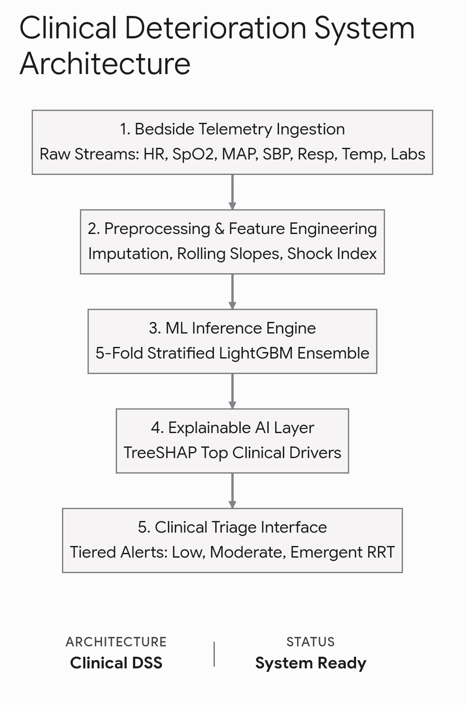
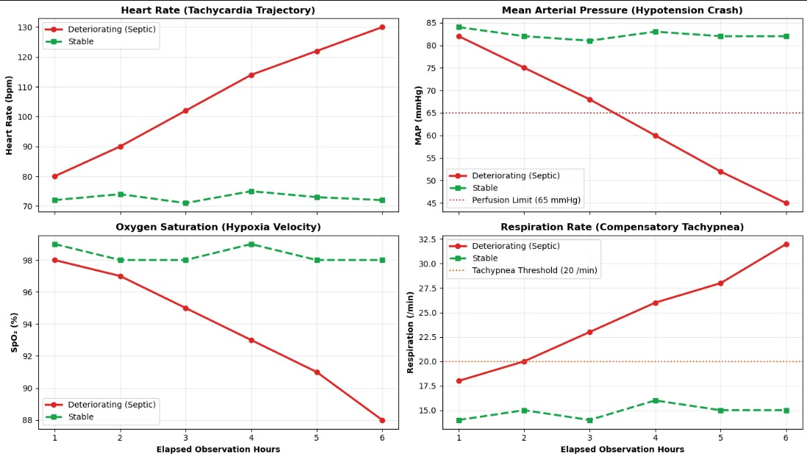
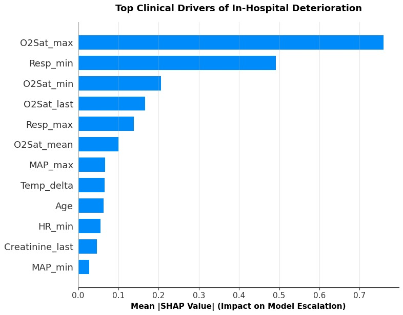
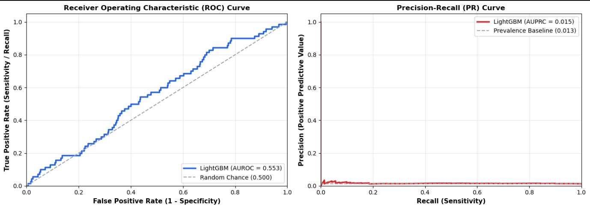

# AI-Powered Real-Time Patient Deterioration & Emergency Decision Support System

## Project Description

Our project is an AI-powered healthcare decision-support system that continuously monitors and analyzes a patient’s real-time health parameters such as Heart Rate, SpO₂, Blood Pressure, Temperature, Respiratory Rate, and Symptoms.

The system does not focus only on diagnosing a disease. Instead, it focuses on early detection of patient deterioration.

AI analyzes the patient’s current vital signs + historical values + trends to identify abnormal patterns and estimate the risk of deterioration. When a potentially critical pattern is detected, the system generates an early warning alert and provides an explainable reason for the alert.

This can help doctors and nurses identify high-risk patients earlier, prioritize urgent cases, and make faster clinical decisions.

### Simple Example

Suppose a patient’s SpO₂ is continuously decreasing:

96% → 94% → 91% → 88%

At the same time, their heart rate is increasing:

82 → 91 → 105 → 118 BPM

A normal system may look at the current SpO₂ = 88% and generate an alert.

But our AI system will analyze the trend and combination of multiple vital signs and recognize that the patient’s condition is deteriorating.

### Example Alert:

> «High Risk of Patient Deterioration
> SpO₂ is continuously decreasing while heart rate is increasing.
> Risk Level: HIGH
> Reason: Significant deterioration trend detected in respiratory and cardiovascular parameters.
> Recommended Action: Immediate clinical assessment required.»

### Main Goal

The goal is to build an AI system that can act as an early-warning and decision-support layer for healthcare professionals, helping them detect potentially critical patients before the condition becomes severe.

**Important:** The system is intended to support doctors and nurses, not replace their clinical judgment or provide an autonomous diagnosis.

---

## Flow Chart of Model

---

## Problem Statement

In hospitals, a patient’s condition can worsen gradually over several hours before it becomes an emergency. Single-reading alarms (for example, “SpO₂ is below 90%”) fire late, because they ignore the direction a patient is heading, and they fire often, which leads to alarm fatigue. Doctors and nurses monitoring many patients at once can miss the early, subtle combination of changes across several vital signs.

**Problem:** How can we use a patient’s current vital signs, historical values and trends to estimate the risk of deterioration early enough for clinicians to act, and explain *why* the alert was raised?

---

## Data Set

- **Format:** Two files in long format
- `raw_train_long.csv` - hourly vitals/labs per patient (6-hour observation window per patient)
- `labels_train.csv` - one label per patient (`1` = deterioration, `0` = no deterioration)
- **Size:** 51,521 patients (165,126 hourly rows)
- **Class imbalance:** 27,188 negative vs only 24,333 positive patients 

---

## Solution

We built a five-stage pipeline (see the flow chart above):

1. **Bedside Telemetry Ingestion** - raw streams of HR, SpO₂, MAP, SBP, Respiration, Temperature and labs.
2. **Preprocessing & Feature Engineering** - imputation of missing values, rolling slopes (trends) and Shock Index.
3. **ML Inference Engine** - a 5-fold stratified LightGBM ensemble that estimates deterioration risk.
4. **Explainable AI Layer** - TreeSHAP shows the top clinical drivers behind each prediction.
5. **Clinical Triage Interface** - tiered alerts (Low, Moderate, Emergent RRT) with the reason and recommended action.

---

## Important Pointers

- The system **supports** doctors and nurses; it does **not** replace clinical judgment or give an autonomous diagnosis.
- It looks at **trends and combinations** of vital signs, not just the latest reading.
- Every alert comes with an **explainable reason** (SHAP), so clinicians can see what drove the risk score.
- Models must be evaluated on **real patients only**, split at patient level.
- This is a research/demo prototype and is **not clinically validated**.

---

## Some Insights from Jupyter Notebook

### 1. Deteriorating vs stable vital-sign trajectories

Over the 6 observation hours, a deteriorating (septic-pattern) patient shows heart rate and respiration rising, while MAP and SpO₂ fall. A stable patient stays flat. The combined direction of change is the signal the system looks for.

### 2. Top clinical drivers (SHAP)

The most influential features are oxygen-saturation features (`O2Sat_max`, `O2Sat_min`, `O2Sat_last`, `O2Sat_mean`) and respiration features (`Resp_min`, `Resp_max`). MAP, temperature change, age, heart rate and creatinine contribute less.

### 3. Model performance

| Metric | LightGBM | Reference |
|---|---|---|
| AUROC | 0.553 | 0.500 (random chance) |
| AUPRC | 0.015 | 0.013 (prevalence baseline) |

**Honest reading:** the current model is only slightly better than chance. With just 333 positive patients and short 6-hour windows, the signal is weak. Next steps are more positive cases, longer patient histories, and better trend features.

---

## Video Explanation of Project

https://youtu.be/uYA0RRmfitI?si=xib8IsOEaBnBHyvH
